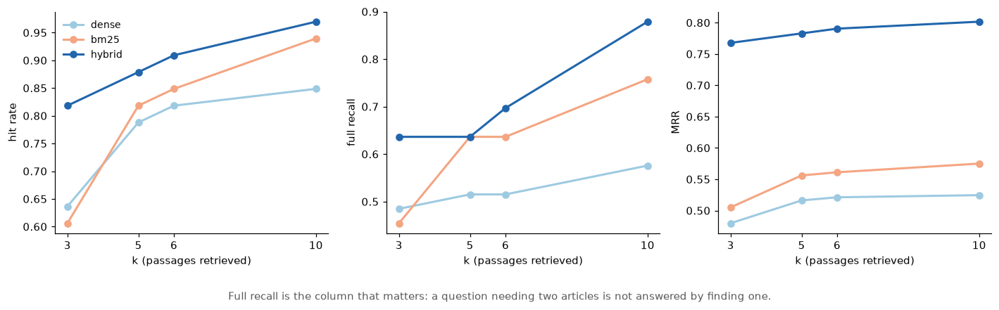
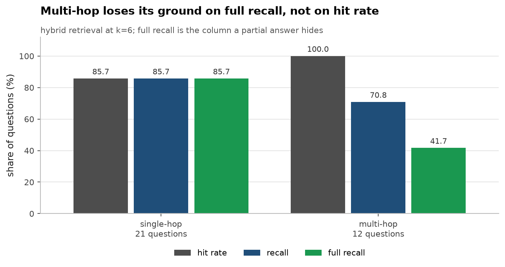
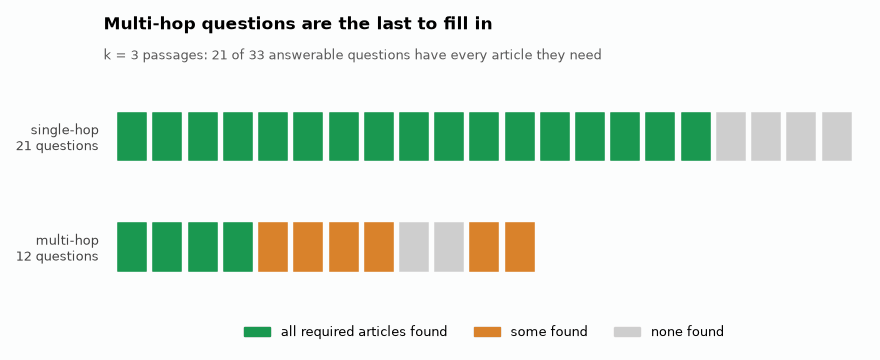
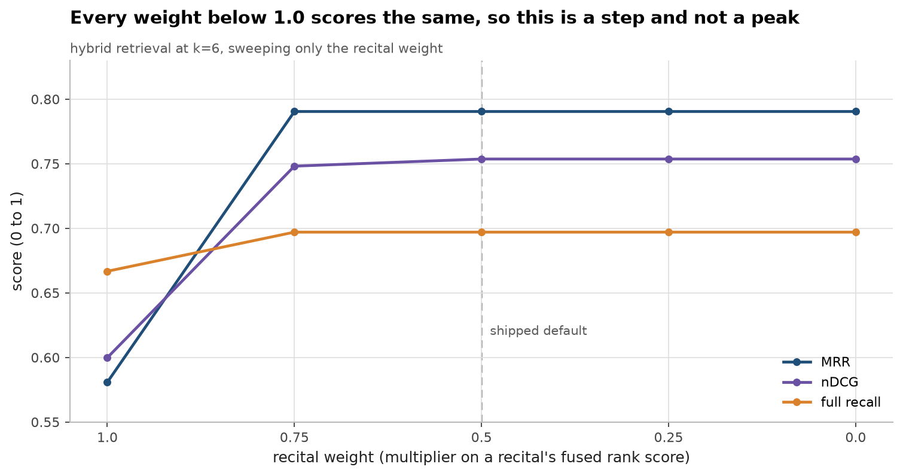
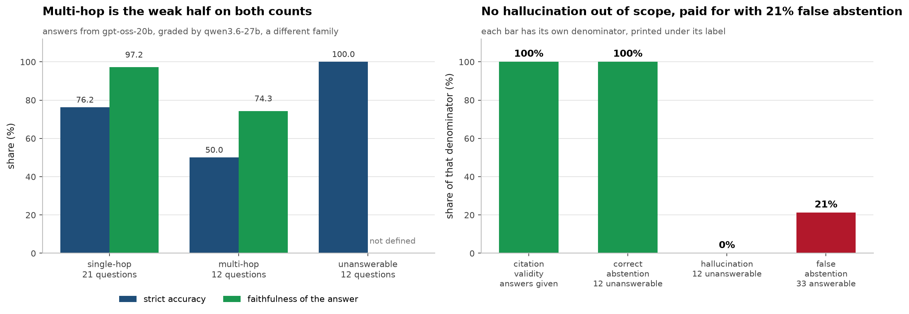
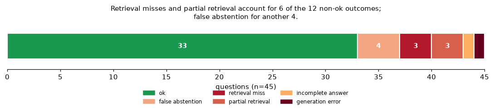
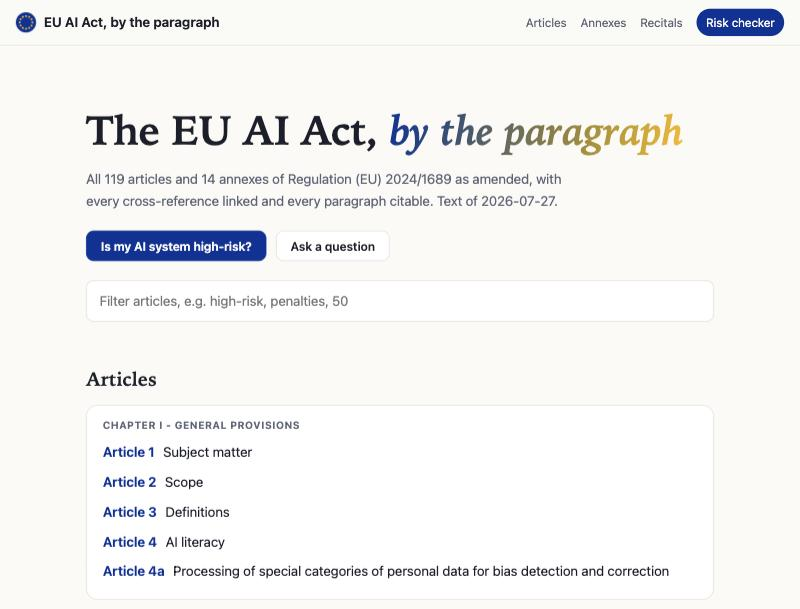
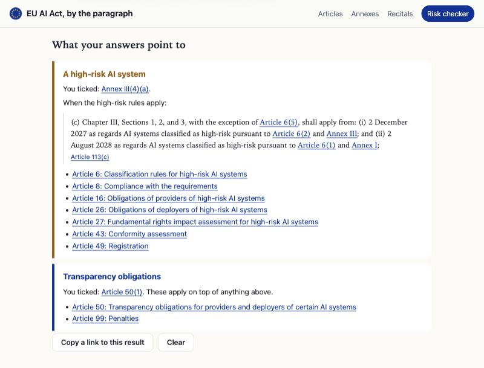

<p align="center"></p>

# EU AI Act RAG, with an evaluation I actually ran

**[▶ Live demo](https://eu-ai-act-rag-eval.streamlit.app/)** · every
answer shows the passages it came from.
**[Browse the Act](https://aghasalim.github.io/eu-ai-act-rag/)** · every article on its own page, cross-references linked.
**[Risk checker](https://aghasalim.github.io/eu-ai-act-rag/checker.html)** · prohibited, high-risk or neither, in the Act's own words.

[](https://github.com/aghasalim/eu-ai-act-rag/actions/workflows/ci.yml)
[](https://github.com/aghasalim/eu-ai-act-rag/actions/workflows/demo.yml)
[](https://github.com/aghasalim/eu-ai-act-rag/actions/workflows/publish-image.yml)
[](https://www.python.org/)
[](LICENSE)
[](https://doi.org/10.5281/zenodo.23003624)

I built a question-answering system over Regulation (EU) 2024/1689 (the EU AI Act),
as amended by Regulation (EU) 2026/1744 (the "Digital Omnibus on AI"). The corpus is
versioned by the date of the text. `2026-07-27` is the consolidated text and the default.
`2024-07-12` is the original Official Journal text, which I kept so the two can be compared.

Most RAG projects, mine included, stop at "look, it answers questions" and never check
whether the answer is in the documents retrieved. I wanted to measure that properly.
So I wrote 45 questions by hand, scored the system against them and wrote down the
failures. Retrieval is decent. 90.9% of questions get at least one
correct provision. It's bad at questions that need two articles at once, though, and
only 41.7% of those get everything they need. I'd rather show you
that number than hide it. Every figure here is recomputed from the per-question
records by independent implementations in `verify/`, and CI fails if any of them
disagree.

Long write-up: **[notes/METHODS.md](notes/METHODS.md)**. Per-question numbers:
**[RESULTS.md](RESULTS.md)**.

<p align="center"></p>

---

## Retrieval



45 hand-written questions over 464 chunks. BM25 beats dense on full recall at every k,
and fusing the two beats both. That last gap is only two questions out of 33, though.
It doesn't survive a paired test, which I only found out by
[recomputing it](#every-number-here-is-recomputed-in-another-language). Retrieval
scoring needs no LLM, so these numbers are free to reproduce.

### Retrieval, k=6

<!-- RETRIEVAL_TABLE:START -->
| strategy | hit rate | recall | full recall | MRR | nDCG | s/query |
|---|---|---|---|---|---|---|
| dense (bge-small) | 81.8% | 67.2% | 51.5% | 0.521 | 0.537 | 0.369 |
| BM25 | 84.9% | 73.2% | 63.6% | 0.561 | 0.571 | 0.002 |
| **hybrid (RRF)** | **90.9%** | **80.3%** | **69.7%** | **0.795** | **0.756** | 0.019 |
<!-- RETRIEVAL_TABLE:END -->

"Hit rate" means at least one required article showed up. "Full recall" means *all* of
them did, and that is the column I care about.



Multi-hop questions are where full recall drops. Hybrid finds something relevant
for 100% of them and everything they need for 41.7%. Keyword search beating embeddings
was the other surprise. I break both down in
[notes/METHODS.md](notes/METHODS.md#three-things-i-did-not-expect).



*Each tile is one of the 33 answerable questions, coloured by how much of what
it needs hybrid retrieval has found. Only k changes across the frames, 3 then
5 then 6 then 10, and the tiles that never fill in are the multi-hop ones.*



Recitals are the non-binding "whereas" paragraphs. They restate the rules in flowing
prose, and they were crowding binding articles out of the top-k. Down-weighting them moved MRR from
0.601 to 0.795. Any weight below 1.0 gives nearly the same result. MRR and full recall
are identical across them, and nDCG only creeps from 0.751 to 0.756. So the gain is a
step. It isn't a peak I fitted to 45 questions.

## Answers

Answers come from `openai/gpt-oss-20b` and are graded by `qwen/qwen3.6-27b`. That's a
different model family, so the grader isn't marking its own work. This covers all 45 questions.

| metric | value |
|---|---|
| **Faithfulness** (claims entailed by retrieved text, averaged over the 26 questions it answered that have an answer) | **90.2%** |
| **Citation validity** (citations pointing at retrieved passages) | **100%** |
| **Correct abstention** on out-of-scope questions | **100%** (12/12) |
| **Hallucination rate** on out-of-scope questions | **0%** |
| Answer accuracy, strict | 66.7% |
| Answer accuracy, incl. partially correct | 69.7% |
| False abstention (refused a question it could answer) | 21.2% |



It refused 12 out of 12 out-of-scope questions and hallucinated on none, even the ones
I wrote to bait it. It leans toward refusing, which is why false abstention is 21%. The
per-type breakdown is in [notes/METHODS.md](notes/METHODS.md#answer-quality-broken-out),
along with the `LLM_MAX_TOKENS` bug that was costing 12 points of accuracy.



Twelve outcomes aren't ok. Six of those are retrieval failures, three complete misses
and three partial. Four more are refusals of answerable questions. Only two are
generation faults where the right evidence was there, so retrieval is where I'd spend the effort.

## The law changed under it

I built and measured this on the 2024 text. On 27 July 2026 the Omnibus changed it.
It moved the high-risk dates, Annex III to 2 December 2027 and Annex I to 2 August 2028.
It added two Article 5 prohibitions. It also replaced Article 4 and added Articles 4a
and 60a, among other changes. So I wrote 11 more questions that only the amended text
can answer. Each one comes with the exact wording its answer rests on, and I ran
retrieval on both texts. The changes I checked and the quote behind every question are in
[notes/AMENDMENTS.md](notes/AMENDMENTS.md).

Hybrid retrieval, k=6:

<!-- STALE_TABLE:START -->
| questions | text searched | answerable | hit rate | full recall | MRR | current wording in top k |
|---|---|---|---|---|---|---|
| original | 2024-07-12 | 33 | 90.9% | 69.7% | 0.795 | n/a |
| original | 2026-07-27 | 33 | 90.9% | 69.7% | 0.785 | n/a |
| amended | 2024-07-12 | 11 | 63.6% | 45.5% | 0.636 | 0.0% |
| amended | 2026-07-27 | 11 | 81.8% | 63.6% | 0.773 | 63.6% |

On the amended questions the 2024 text still finds a provision with the right number for 63.6% of them, and the current wording for 0.0%. On the 2026 text that is 81.8% and 63.6%.
<!-- STALE_TABLE:END -->

A stale RAG system hides this kind of failure. If you measure it the usual way, by
whether the right article number comes back, the old corpus still looks respectable on
questions about the new law. That's because most amendments rewrite an article without
renumbering it. But not one retrieved chunk holds the current wording. So any answer
built on it states the old rule with a correct-looking citation. There are two articles
it can't return at all, 4a and 60a, because they didn't exist in 2024.

The two plain date questions (a01, a02) miss Article 113 on both texts. Their top 6 is
all articles about high-risk systems (6, 8, 43 and so on), and none of them is the
article that holds the dates. It's the same weakness that cost s02 on the original run.
Also, the answer numbers above were measured on the 2024 text. I haven't re-run
generation on the amended one, so there's no answer-level comparison yet, only retrieval.

Three of the original 45 questions are now out of date (m04 superseded, s15 and m12
incomplete). They're marked in `qa_set.jsonl` and left as they were, since they're
right for the text the published numbers were measured on.

## Citing the paragraph, not the article

People cite a legal answer as "Article 6(3)" rather than "Article 6", so I added a
second chunking. It makes one chunk per numbered paragraph, or per top-level point where an
article has no numbered paragraphs (Article 3's definitions, Article 113's dates).
Every line is labelled with its place in the outline, so a chunk knows it's
Article 5(1) and holds points (f) to (h). The text is the same and only the cut differs.
The 2024 text gives 921 chunks instead of 464. The 2026 text gives 994 instead of 498.

Each of the 56 questions with an answer now also has gold paragraph references
(`gold_refs`, e.g. `art_5(1)(f)`). A test checks that every one of them exists
in the corpus. The new metrics treat each retrieved chunk as a citation of whatever it's
labelled as, and they compare at paragraph level. So Article 5(1)(f) and 5(1)(h) count as
the same paragraph, while 6(3) and 6(4) don't. Citation precision is the share of
distinct cited paragraphs that are gold.

Hybrid retrieval, k=6 (`make eval-paragraph`):

| questions | chunks | hit rate | full recall | MRR | paragraph hit | paragraph full recall | paragraph MRR | citation precision |
|---|---|---|---|---|---|---|---|---|
| original, 2024 text | article | 90.9% | 69.7% | 0.790 | 0.0% | 0.0% | 0.000 | 0.000 |
| original, 2024 text | paragraph | 97.0% | 75.8% | 0.843 | 90.9% | 75.8% | 0.757 | 0.176 |
| amended, 2026 text | article | 81.8% | 63.6% | 0.773 | 0.0% | 0.0% | 0.000 | 0.000 |
| amended, 2026 text | paragraph | 81.8% | 63.6% | 0.818 | 81.8% | 54.5% | 0.773 | 0.155 |

The article rows are zero by construction. An article chunk can only be cited as
the whole article. Only one gold reference is article level (s02, the general application
date in Article 113's unnumbered text), and hybrid misses it.
Citation precision at k=6 also has a low ceiling. Most questions have one or two gold
paragraphs and six citations. A perfect ranker would score 0.232 on the original
set and 0.212 on the amended one. At k=3 it's 0.308 against a ceiling of 0.465.

I didn't expect smaller chunks to help at article level too, but they did on the
original questions. Full recall went from 69.7% to 75.8%, which is two more questions. On 33
questions that isn't a significant gap. It didn't cost anything either, so
search and the app now use paragraph chunks. The published answer numbers above
were measured on article chunks, and `make eval` still reproduces them that way.

## A bigger question set

45 questions was too few to say much, so I wrote 67 more in
`eval/qa_extended.jsonl` from the 2026 text. That makes 123 written, and 122 in use once the
superseded `m04` is dropped. Each one has gold
article and paragraph references, a short gold answer and the exact wording the
answer rests on. `make check-qa` (also a test in CI) checks all three files against
the corpus. Every gold reference has to exist and every quote has to sit inside a gold
paragraph. In the new set, every gold paragraph also has to hold a quote. The check
works out which questions quote wording the 2024 text doesn't have, too. 13 of the 67 do.

| topic | questions |
|---|---|
| high-risk classification and obligations | 28 |
| prohibited practices | 7 |
| general-purpose AI models | 7 |
| transparency | 5 |
| penalties | 6 |
| dates and transitional periods | 6 |
| provisions added by the 2026 amendments | 8 |

Hybrid retrieval on the 2026 text, k=6 (`make eval-extended`). "All" is the three
sets together, minus m04, which the amendments superseded. That leaves 110 questions with an answer.

| questions | chunks | answerable | hit rate | full recall | MRR | paragraph full recall | citation precision |
|---|---|---|---|---|---|---|---|
| new 67 | article | 67 | 95.5% | 89.6% | 0.812 | 0.0% | 0.000 |
| new 67 | paragraph | 67 | 98.5% | 92.5% | 0.865 | 86.6% | 0.171 |
| all | article | 110 | 92.7% | 80.9% | 0.799 | 0.9% | 0.002 |
| all | paragraph | 110 | 96.4% | 83.6% | 0.853 | 79.1% | 0.169 |

The new questions are easier than the original 45, and I think I know why. I wrote
them with the paragraph open, so they reuse its words, and that's what BM25 rewards.
The original set was written to be harder and still is. I'd treat the new numbers as a
regression check for the paragraph chunker and the amended text. They don't tell you
how the system does on real users' questions. Paragraph chunks were
better than article chunks on all of it, by 2.7 points of full recall on the 110.
There are 13 questions that need the amended wording. With paragraph chunks, 10 of them
get it in the top 6. With article chunks, 11 do.

## Two-part questions

Multi-hop was the weakest number here, so that's where I looked next. Most of the
misses have the same shape. The question asks two things, like what a chatbot
provider must disclose and what the fine is, and the two answers sit in different
articles. Embedded as one query, the first half drowns the second.

`split` mode cuts the question at sentence ends, and at an "and" or a comma that
starts a new question. It runs hybrid search on the whole question and on each part,
and deals the results out in turn. It also keeps at most two chunks of any one
article, because paragraph chunks of a single long article were filling the top 6.
A question with one part gets plain hybrid with that cap. There's no model in it, so
it adds a few milliseconds.

I tried three other things on the same questions: a cross-encoder reranker
(`bge-reranker-base` over the top 30), a copy of the embedder fine-tuned on
synthetic questions (next section), and indexing each passage together with the
titles of what it refers to (below). `make experiments` runs all of it with no API key.
The last two columns compare each row with the first, question by question, on full
recall: how many questions got better and worse, and the exact sign test on those.

<!-- EXPERIMENTS_TABLE:START -->
**original 45, 2024 text, article chunks** (33 with an answer), k=6

| variant | hit rate | full recall | multi-hop full recall | MRR | better / worse | p |
|---|---|---|---|---|---|---|
| hybrid, bge-small (baseline) | 90.9% | 69.7% | 41.7% | 0.795 | n/a | n/a |
| + reranker | 97.0% | 84.9% | 66.7% | 0.813 | 5 / 0 | 0.062 |
| + split and cap (mode: split) | 93.9% | 78.8% | 58.3% | 0.817 | 4 / 1 | 0.375 |
| + reference titles | 93.9% | 72.7% | 41.7% | 0.821 | 2 / 1 | 1.000 |
| + split and cap + reference titles | 97.0% | 84.9% | 66.7% | 0.847 | 6 / 1 | 0.125 |
| hybrid, bge-small-euaiact | 97.0% | 84.9% | 66.7% | 0.846 | 5 / 0 | 0.062 |
| + split and cap, bge-small-euaiact | 100.0% | 84.9% | 58.3% | 0.848 | 6 / 1 | 0.125 |
| + split and cap + reference titles, bge-small-euaiact | 97.0% | 84.9% | 66.7% | 0.857 | 6 / 1 | 0.125 |

**all 122, 2026 text, paragraph chunks** (110 with an answer), k=6

| variant | hit rate | full recall | multi-hop full recall | MRR | better / worse | p |
|---|---|---|---|---|---|---|
| hybrid, bge-small (baseline) | 97.3% | 84.5% | 26.3% | 0.862 | n/a | n/a |
| + reranker | 97.3% | 87.3% | 42.1% | 0.852 | 4 / 1 | 0.375 |
| + split and cap (mode: split) | 97.3% | 90.0% | 57.9% | 0.856 | 6 / 0 | 0.031 |
| + reference titles | 98.2% | 85.5% | 26.3% | 0.864 | 1 / 0 | 1.000 |
| + split and cap + reference titles | 98.2% | 90.9% | 57.9% | 0.860 | 7 / 0 | 0.016 |
| hybrid, bge-small-euaiact | 99.1% | 88.2% | 36.8% | 0.896 | 5 / 1 | 0.219 |
| + split and cap, bge-small-euaiact | 99.1% | 92.7% | 63.2% | 0.890 | 9 / 0 | 0.004 |
| + split and cap + reference titles, bge-small-euaiact | 98.2% | 91.8% | 63.2% | 0.869 | 9 / 1 | 0.021 |
<!-- EXPERIMENTS_TABLE:END -->

On the 110 questions with an answer, split search took six questions from missing
something to full recall and none the other way. Multi-hop full recall went from
26.3% to 57.9%. That starting point is lower than the 41.7% above because this is the
bigger set on paragraph chunks, with 19 multi-hop questions where the original set
has 12. The reranker helped less there and added nothing on top of splitting, so it
stays in the experiment script and out of the package. On the original 45 it was the
other way round, the reranker did a little better than splitting, and neither gap is
significant on 33 questions.

Two warnings. I wrote the splitting rule after reading the failing questions, and 19
multi-hop questions is a small set, so this needs new questions before I'd trust the
size of the gain. It also doesn't fix dates. Of the eight multi-hop questions split
search still fails, five need Article 113, which names chapters ("Chapters I and II
shall apply from 2 February 2025") and never the thing the question asks about.

So I tried the obvious fix for that. The `+ reference titles` rows index each passage
with the titles of the chapters, sections, articles and annexes it refers to, so
Article 113(b) also says "general-purpose AI models". It didn't work. Article 113
moves up the list for most of the date questions, but into the top 6 for one of them.
On the 110 questions that is one more question at full recall with the stock embedder
(90.0% to 90.9%) and one fewer with the fine-tuned one (92.7% to 91.8%), and multi-hop
doesn't move in either. On the original 45 it finds two more with the stock embedder
and none with the fine-tuned one. None of that is a result, so it stays in the
experiment script. The dates need something else.

Dense search runs in memory in this script and through Chroma's approximate index
everywhere else, so the baseline row can sit a question away from the tables above.

`split` is now the default for search and the app. The published numbers above were
measured on plain hybrid, and `make eval` still uses that.

## Fine-tuning the embedder

The embedder is `bge-small-en-v1.5` off the shelf, and BM25 beats it on this text. So
I fine-tuned it on questions about this text. A local model (Qwen2.5-14B through
mlx-lm) wrote three questions for each of the 779 binding chunks of the 2026 text: a
short search, a scenario and one in everyday words. That gave 2,267 questions, in
`train/synthetic_queries.jsonl`. `train/finetune.py` holds out a tenth of the chunks
with their questions, trains on the rest with in-batch negatives for four epochs, and
is one run with fixed settings. It refuses to start if a synthetic question is also
an eval question.

On the held-out tenth, 225 questions about chunks the model never trained on, dense
recall at 6 went from 60.0% to 86.7%. On the hand-written questions it's the
`bge-small-euaiact` rows in the table above. With split search that is nine questions
better and none worse on the 110, and 92.7% full recall.

The model has seen most of the passages the eval questions are about, with other
questions attached. That's what adapting an embedder to one fixed text means, and it
says nothing about how it would do on a different law. The synthetic questions also
come from one model and one prompt.

The weights are on Hugging Face as
[aghasalim/bge-small-euaiact](https://huggingface.co/aghasalim/bge-small-euaiact), and
`make experiments` downloads them, so the table above reproduces without training
anything. `make train` rebuilds them from the committed questions (27 minutes on an M5
Max that was busy with other work), and a model trained that way is used in place of
the download. `EMBED_MODEL=aghasalim/bge-small-euaiact make index` switches search to
them. The default is still the off-the-shelf model. The published numbers above were
measured with it, and changing the default would change what `make eval` measures.

## The Act as a website

`make site` turns the corpus into a static site with no dependencies: one page per
article and annex, each numbered paragraph with its own link, every reference to
another article or annex linked, and a list of the articles that refer back.
References to other laws ("Article 9 of Regulation (EU) 2016/679") are left
unlinked on purpose. It deploys to GitHub Pages from `.github/workflows/pages.yml`.

Because the corpus holds both texts, each amended article also shows what changed
against the 2024 original, word by word, and `changes.html` lists the 7 articles and
annexes the 2026 amendments added and the 51 they changed. I looked for another free
site that shows the consolidated text next to the original and didn't find one. The
comparison is computed, so a layout difference between the two source documents can
show up as a change. Footnote markers and spacing are evened out first. The same text
is published as `act.json`, every line with its anchor.

<p align="center">


</p>

The risk checker asks which points of Article 5(1), Article 6, Annex III and
Article 50 describe a system, and shows the provisions those answers point to,
with the date from Article 113. I didn't write any of its questions. Each option is
the text of the point, read from the corpus when the site is built, so an amendment
that changes a point changes the checker. The build fails if Article 6(3), 6(4) or the
points of Article 113 it quotes stop saying what the result panels rely on. The
selection is kept in the URL, so a result can be shared as a link. It's a reading
aid. It doesn't decide anything, and it only covers those provisions.

## Checking the judge

The answer grades above come from an LLM judge, so I graded 41 of the same answers
by hand. I worked from the text of the Act and didn't look at the judge's grade. They're
every non-empty answer that didn't abstain in two runs of the same generator, with
answers identical across the runs counted once. The labels, with a note on each
mistake, are in `eval/human_labels.jsonl`, and I made all of them myself. `make agreement`
compares them with the stored outputs, so it needs no API key.

| what is compared | items | agreement | Cohen's kappa |
|---|---|---|---|
| judge grade, correct / partial / incorrect | 41 | 82.9% | 0.52 |
| judge grade, correct against not correct | 41 | 82.9% | 0.48 |
| abstention rule (`NOT_IN_CORPUS` in the answer) | 45 | 100% | 1.00 |

All 7 disagreements are about "partial". The judge marked 5 answers partial that I
marked correct. Four of those were for leaving out a detail of the reference that I didn't
think the question needed (s13, s21, m01, m10). One was for a sentence cut off after the
answer was already given (s17). It also marked
m04 correct twice where I marked it partial. The list of articles is right, but the
answer describes Articles 102 to 109 and 112 wrongly, and the judge only compares
against the reference. So it's strict about omissions but doesn't catch wrong extra
claims. On the published run the disagreements cancel out. Strict accuracy is 66.7% and
lenient is 69.7% under either set of grades. Every answer either of us called incorrect,
both of us did.

The citation validity number depends on the citation parser. It agrees with my
reading of what each answer cites on 80.5% of answers. It never invents a citation,
so precision is 100%. It does miss 20.4% of them (recall 79.6%). Most misses are citations
outside brackets, like "Article 55(c)" in bold or "Article 49(2) requires" in running text.
Two are brackets left unclosed by an answer that was cut off. So the citation validity
figure is computed over the bracketed citations only.

I haven't checked the claim-level faithfulness judge. That needs each claim read
against the retrieved passages, and I haven't done it yet. There's no API key
on this machine, so the judge hasn't been re-run either. `eval/agreement.py --rejudge
MODEL` grades the same 41 answers with a live judge and adds it to the comparison
once a key is in `.env`.

## Method, briefly

I take the official XHTML from the EU Publications Office Cellar API (CELEX `32024R1689`)
and chunk it on the document's own articles, recitals and annexes. The answer to a
legal question is a citation, so that's the natural cut. That gives 113 articles + 180 recitals + 13 annexes → **464 chunks**,
all under the encoder's 512-token limit. The amended text (CELEX `02024R1689-20260727`)
comes from the same API in different markup. It has no preamble, so the unamended
recitals are carried over: 119 articles + 180 recitals + 14 annexes → 498 chunks.
Retrieval is `BAAI/bge-small-en-v1.5` in Chroma fused with BM25 by Reciprocal Rank Fusion.
RRF ranks by position, so there's no scaling constant to fit. There's more detail in
[notes/METHODS.md](notes/METHODS.md#3-method), and the test set is described in
[notes/METHODS.md](notes/METHODS.md#4-the-test-set).

## Running it

```bash
make setup && make corpus && make index
make eval-retrieval
```

That reproduces every retrieval number above. It needs no API key and makes no LLM calls, so it's free.
`make eval-versions` adds the runs on the amended text and the amended questions.
`make eval-paragraph` compares article and paragraph chunks, and `make eval-extended`
runs the 122-question set. `make experiments` compares split search, the reranker and
a fine-tuned embedder with the baseline. `make site` builds the website into `_site/`.

For generated answers, add a free [Groq](https://console.groq.com/keys) key:

```bash
cp .env.example .env && echo "GROQ_API_KEY=your_key_here" >> .env
make eval && make report && make app
```

### As a package

The code installs as `euactrag`, with a command and two functions:

```bash
pip install .            # or: pip install dist/euactrag-0.1.0-py3-none-any.whl
euactrag fetch && euactrag ingest && euactrag index
euactrag search "Is emotion recognition at work prohibited?" -k 3
euactrag ask "What fine applies to a prohibited practice?"    # needs an LLM key
```

```python
import euactrag
hits = euactrag.search("When do the Annex III rules apply?", k=3)
print(hits[0]["citation"], hits[0]["ref"])
```

Outside a checkout the corpus and index go to `~/.cache/euactrag`, or wherever
`EUACTRAG_DATA` points. `make dist` builds the sdist and wheel and checks them, and
CI does the same on every push and installs the wheel on its own. It isn't on PyPI.

Or pull the container:

```bash
docker run -p 8501:8501 ghcr.io/aghasalim/eu-ai-act-rag:latest
```

`make docker` builds it locally. Image size and hosting notes are in
[notes/METHODS.md](notes/METHODS.md#7-docker).

## Limitations

- **41.7% full recall on multi-hop questions** with plain hybrid. It's the biggest
  weakness by far. Split search helps, but questions about dates still miss
  Article 113, and I wrote the rule after reading the failures.
- **I wrote every question myself** for a system I also built. The headline numbers
  rest on the original 45, and small differences there are noise. The 67 added later
  share wording with the text they were written from, so they flatter retrieval.
- **The answer numbers are for the 2024 text.** Retrieval has been measured on both
  texts; generation only on the original.
- **The consolidated text has no legal effect.** Only the Official Journal texts are
  authentic. I checked every change I rely on against the amending act itself.
- **No questions where a recital is the right answer.** That makes the recital
  down-weighting look better than it probably is.
- **English only.** The Act is equally valid in 24 languages and I've tested one.
- This is a student project and it isn't legal advice. Please don't make compliance decisions with it.

Full list in [notes/METHODS.md](notes/METHODS.md#5-limitations).

## Repository layout

```
src/euactrag/    fetch → ingest (chunking) → index → retrieve → pipeline
eval/            qa_set.jsonl · qa_amended.jsonl · metrics.py · judge.py · run_eval.py · report.py · experiments.py
train/           synthetic questions and the embedder fine-tune
site/            static site generator: a page per article, and the risk checker
assets/          README banner, terminal animation and its generator
app/             Streamlit UI, shows the answer next to its sources
tests/           corpus integrity, metric maths, citation parsing
deploy/          Hugging Face Space template
notes/           METHODS.md, the long-form write-up · AMENDMENTS.md, the 2026 changes
verify/          the same numbers, recomputed independently
```

## Credit

The corpus is Regulation (EU) 2024/1689 from the Official Journal of the European Union,
via the EU Publications Office (CELEX 32024R1689), and its consolidated text as amended
by Regulation (EU) 2026/1744 (CELEX 02024R1689-20260727). Reuse is covered by Decision
2011/833/EU. Nothing here is affiliated with or endorsed by the EU.

The code is MIT ([LICENSE](LICENSE)). The corpus is not mine to licence, so its
attribution lives in [NOTICE](NOTICE).
